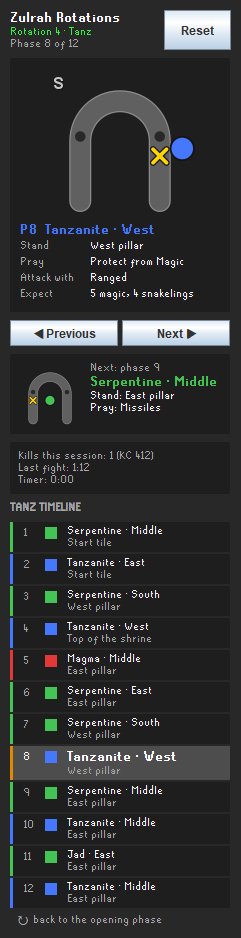
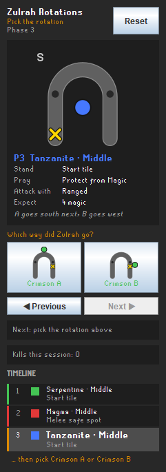
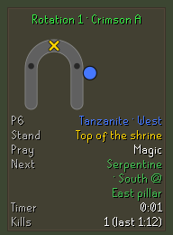
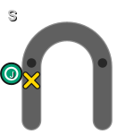
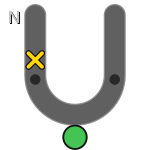

# Zulrah Rotations

A manual rotation guide for Zulrah. You tell the plugin which rotation Zulrah is in and
step through the phases yourself; the plugin shows you, for the phase you picked, where
Zulrah is, where to stand, what to pray and what to expect.

The plugin never looks at Zulrah. See [Rules compliance](#rules-compliance).

| Side panel | Picking a branch | Overlay |
|---|---|---|
|  |  |  |

Diagram options:  

## Features

- **Rotation picker.** The fight always opens the same way. When the rotations split, the
  panel offers the possible branches (Crimson, Serp, Tanz, then Crimson A or B) as buttons
  with a preview of the next phase. Pick the one that matches what you see.
- **Phase stepper.** Next and previous via panel buttons or hotkeys. Hotkeys work while the
  game window has focus.
- **Per-phase guide data.** Zulrah's form (serpentine, magma, tanzanite, Jad), Zulrah's
  position, the stand tile, the prayer a guide recommends, the attack style to use and the
  attacks, venom clouds and snakelings the wiki lists for that phase.
- **Shrine diagram.** A vector-drawn horseshoe with Zulrah's position and your tile, drawn in
  the wiki chart orientation (camera facing south) with an option to rotate it.
- **Side panel.** Current phase card with a large diagram, next-phase preview, picker, kill
  stats and a clickable timeline of the whole rotation.
- **In-game overlay.** Compact, movable and resizable: status, a small diagram, current phase,
  stand tile, prayer, next phase, timer and kills.
- **Chat commands.** `::zulrot N` sets the rotation (1 Crimson A, 2 Crimson B, 3 Serp,
  4 Tanz; names also work), `::zulphase N` jumps to a phase.
- **Chat help.** When you enter the shrine with no rotation chosen, one chat message explains
  the panel, hotkeys and commands.
- **Remembers progress per account.** The rotation and phase are stored through RuneLite's
  profile configuration, so a relog or client restart does not lose them.
- **Reset on demand**, plus automatic reset when you leave the shrine or the game reports your
  death.
- **Kill counter and timer** read from chat: kills this session, your kill count, the last
  fight duration, and a timer that starts when you enter the shrine and stops on the kill
  count message.
- **Colourblind palette** for the form colours.
- **Kill summaries.** After each kill or death: time, rotation, damage taken (venom separated),
  hits, food, potions and prayer points used, broken down by the phases you stepped through,
  with the worst phase called out. A session card keeps kills, deaths, average damage, best
  time, supplies used and the phase that has cost you the most. Also posted as one chat line.

## Using it

1. Enable the plugin. When you reach Zul-Andra or the shrine the sidebar icon appears and
   the panel opens on its own (both configurable).
2. Set hotkeys for Next, Previous and Reset in the plugin settings. Rotation hotkeys 1 to 4
   are optional.
3. Start a kill. The panel shows the opening phase. When Zulrah dives, pick the branch that
   matches where it surfaces, then press Next each time it moves.
4. If the plugin and the fight disagree, click any phase in the timeline, type `::zulrot N`
   or `::zulphase N`, or press Reset.

## Config

| Section | Option | Default | What it does |
|---|---|---|---|
| Display | Show | Both | Side panel, overlay, or both |
| Display | Overlay diagram | On | Draw the small shrine diagram in the overlay |
| Display | Overlay next phase | On | Show the upcoming phase in the overlay |
| Display | Diagram orientation | South at top | Which compass direction is at the top of the diagram |
| Display | Colourblind palette | Off | Teal, orange and blue instead of green, red and blue |
| Display | Sidebar icon only at Zulrah | On | Hide the sidebar icon away from Zul-Andra and the shrine |
| Display | Open panel on arrival | On | Open the side panel when you reach Zul-Andra or the shrine |
| Display | Show prayer and attack details | On | Print the recommended prayer and expected attacks for the selected phase. Off, the plugin is a position guide only |
| Behaviour | Reset when leaving | On | Back to the opening phase when you leave the shrine instance |
| Behaviour | Reset on death | On | Back to the opening phase when the game says you died |
| Behaviour | Remember progress per account | On | Store rotation and phase in the account profile |
| Behaviour | Chat help when unsure | On | One chat message on entering the shrine with no rotation chosen |
| Behaviour | Hotkeys everywhere | Off | Let hotkeys work outside the Zulrah area |
| Hotkeys | Next, Previous, Reset, Rotation 1 to 4 | Unset | Keybinds |
| Kill stats | Show kill stats | On | Kills, last fight duration and timer |
| Learner | Kill summaries | On | Record damage, supplies and prayer per phase and show the last kill and session cards |
| Learner | Summary in chat | On | Post the one-line kill summary as a game message |

## Rules compliance

Jagex's third-party client guidelines do not allow clients to predict a boss's next attack,
show projectile landing spots, drive prayer indicators from game state, or signal when a boss
mechanic starts or ends. This plugin is built as a manually triggered helper:

- **The player drives every state change.** Phases advance only on a button click, a hotkey,
  a timeline click or a chat command. The plugin has no code path that advances a phase by
  itself.
- **Zulrah is never read.** The plugin does not look at NPC ids, forms, animations, positions,
  spawns, projectiles, hitsplats or graphics objects. There is no rotation detection.
- **Prayer and form text is static guide data** attached to the phase the player selected,
  the same as a printed rotation chart. It does not react to anything Zulrah does.
  The prayer and expected-attack lines can be switched off with "Show prayer and attack
  details"; with it off the plugin shows only form, position and stand tile.
- **Game state that is read, and why:**
  - the map region ids and the instance flag, to show or hide the sidebar icon and overlay,
    to enable hotkeys only near Zulrah, and to reset when the player leaves the shrine;
  - game chat messages, for the kill count, the fight duration, the "you are dead" reset, and
    the "You eat" and "You drink" lines that count food and potions;
  - the player's own character only: hitsplats that land on the local player, and the local
    player's prayer level, for the kill summaries. Damage is bucketed by the phase the player
    selected by hand, so the summaries say nothing about Zulrah that the player did not type in.
    Summaries are shown only after a kill ends; nothing new is drawn during the fight.
- **No in-scene drawing.** Nothing is drawn on the game world. A tile marker for the suggested
  stand tile, driven purely by the manually selected phase, was considered and left out; it is
  listed below as an open question for reviewers rather than shipped.

### Open question for reviewers

Would a ground tile highlight for the suggested stand tile be acceptable if it is off by
default and driven only by the phase the player selected by hand? It is not in this release.

## Data source

Phase order, forms, positions, attack counts, venom clouds, snakelings and the Jad prayer
order follow the "Rotation overview" on the OSRS Wiki page Zulrah/Strategies. Position names
use the wiki's convention: the chart is drawn with the camera facing south, so "south" is
the far end of the shrine, "east" is to your left and "west" to your right.

## Building

Standard RuneLite plugin layout. `./gradlew build` compiles and runs the unit tests;
`./gradlew run` launches a development client with the plugin loaded.

## Credits

Rotation data: the OSRS Wiki community. License attributions are in `LICENSE`.

## Changelog

### 1.0.0 (2026-10-28)
- First release: rotation picker, phase stepper with hotkeys, side panel with diagram and
  timeline, in-game overlay, `::zulrot` and `::zulphase` commands, per-account memory, reset
  on leave and death, kill counter and timer from chat, colourblind palette.
- Side panel opens by itself on arrival at Zulrah (configurable).
- Kill summaries: per-phase damage, venom, food, potions and prayer after each kill, plus
  session totals, read only from the player's own hitsplats, prayer level and chat.
- "Show prayer and attack details" option to run the plugin as a position guide only.
